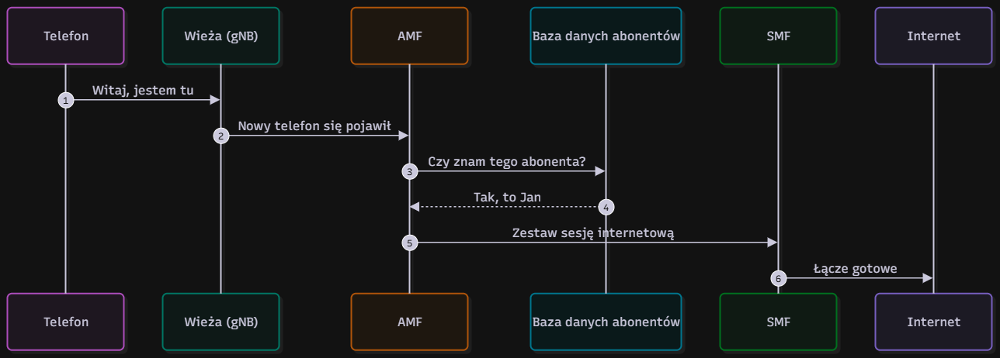

# Dziennik — Temat 1: Rdzeń sieci 5G (SBA)

## 1. Lista komunikatów (scenariusz włączania telefonu)
1. Telefon -> Wieża: "Witaj, jestem tu"
2. Wieża -> AMF: "Nowy telefon się pojawił"
3. AMF -> Baza danych abonentów: "Czy znam tego abonenta?"
4. Baza danych abonentów -> AMF: "Tak, to Jan"
5. AMF -> SMF: "Zestaw sesję internetową"
6. SMF -> Internet: "Łącze gotowe"

## 2. Diagram sekwencji

## 3. Pytania, które się pojawiły
- Co się dzieje, gdy baza danych abonentów nie odpowiada w trakcie rejestracji?
- W jaki sposób AMF wybiera odpowiednią instancję SMF w dużej sieci?

## 4. Podział ról w zespole
- **Valeriia Koval:** symulator, diagramy.
- **Darya Drozd:** dokumentacja, prezentacja.